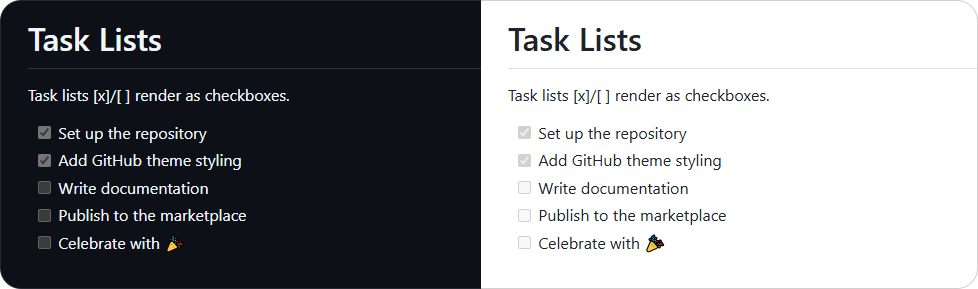
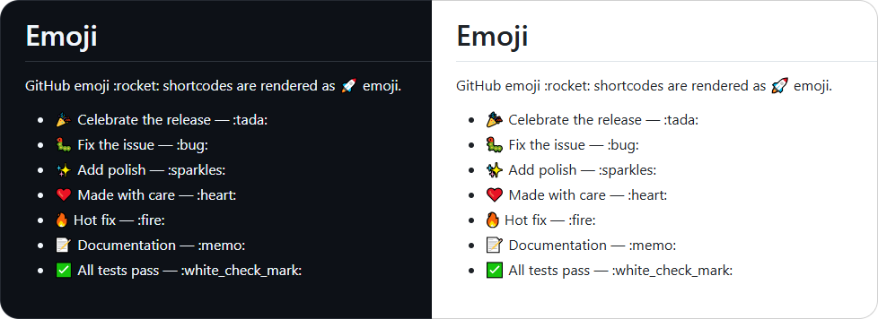
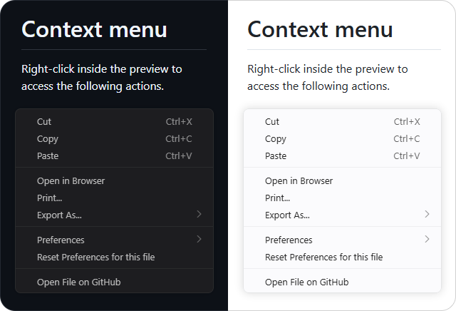
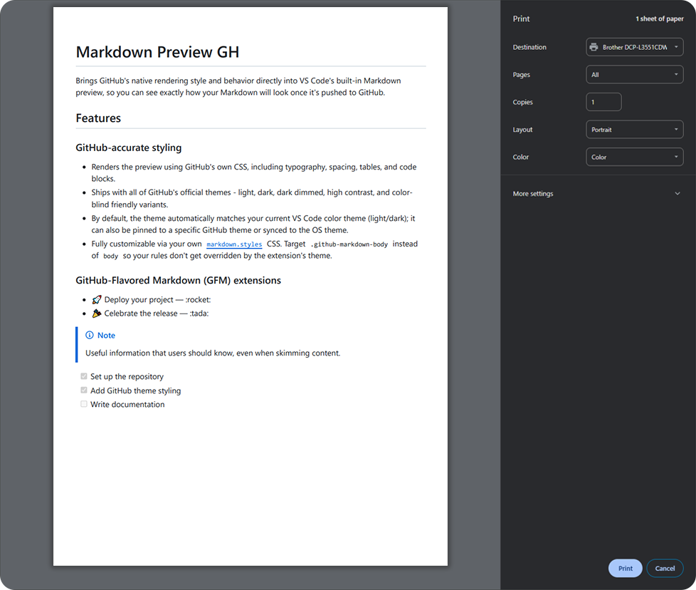

<!-- LOGO_START -->
<p align="center">
  
</p>
<!-- LOGO_END -->

<h1 align="center">Markdown Preview GH</h1>

A polished Markdown preview for VS Code. It does everything you expect from a preview and adds the details that make reading comfortable: GitHub's familiar look in light and dark, Mermaid diagrams, right-to-left support, and layout settings you can tune for each file.


## Features

### GitHub-style rendering

The preview is drawn with GitHub's own typography, spacing, tables, and code blocks, so your document reads the way it will on GitHub.

- Light and dark themes are built in.
- By default the theme follows your VS Code color theme. You can also pin it to light or dark.
- Your own [`markdown.styles`](https://code.visualstudio.com/Docs/languages/markdown#_using-your-own-css) still apply. Target `.mpgh-body` instead of `body` so your rules are not overridden by the extension's theme.

### Code blocks

Fenced code blocks use GitHub's syntax highlighting and spacing.


### Alerts

`> [!NOTE]`, `[!TIP]`, `[!IMPORTANT]`, `[!WARNING]`, and `[!CAUTION]` blockquotes become colored callout boxes with icons instead of plain quotes.


### Task lists

`- [ ]` and `- [x]` items render as real, read-only checkboxes.



### Emoji shortcodes

`:tada:`, `:rocket:`, `:bug:`, and the rest of GitHub's shortcode set turn into their emoji automatically.



### Mermaid diagrams

Fenced `mermaid` code blocks render as diagrams, ZenUML included. Diagrams follow the preview's theme, so they look right in light, dark, and per-file theme overrides.


### Right-to-left (RTL) support

- Set the content direction to `LTR`, `RTL`, or `Auto`, which detects the direction from the document itself.
- Code blocks always stay left-to-right, because source code is written that way.
- When the direction is RTL, alert titles (Note, Tip, Important, Warning, Caution) appear in Arabic.


### Per-file preferences

Content direction, content width, and theme can be set for a single file without touching your global settings. Right-click inside the preview to reach them:

<p align="center">
  
</p>

- **Preferences** - a submenu that lists every option in three groups, with a check mark (✔) beside the option in effect for this file:
    - **Width** - `Narrow` (640px), `Normal` (838px, GitHub's own width), `Wide` (1024px), or `Full` (1200px).
    - **Direction** - `Auto` (detected from the content), `LTR`, or `RTL`.
    - **Theme** - `Auto` (follow the editor's light or dark theme, even when your global theme setting is pinned), `Dark`, or `Light`.
- **Reset Preferences for this file** - clear this file's overrides and return to your global settings.

<p align="center">
  
</p>

<!--Auto-Stripping-By-DevDeck-During-The-Publishing-Process-For-Marketplace--[!NOTE]-not-supported-->

> [!NOTE]
> These choices are remembered for the file in the current workspace, and they never affect other files.

### Copy as an image

Right-click inside the preview and copy part of the document to the clipboard as a PNG image, ready to paste into a chat, a document, or an issue. Four commands are available:

- **Copy This Section As PNG** - right-click a heading to copy its whole section.
- **Copy This Table As PNG** - right-click a table to copy it.
- **Copy This Code Block As PNG** - right-click a code block to copy it.
- **Copy This Diagram As PNG** - right-click a diagram to copy it.

### Copy This Section As PNG

Right-click a heading and choose **Copy This Section As PNG**. The section is copied up to the next heading of the same or a higher level, so its subsections are included, and a message confirms that it was copied. Then paste it where you need it, for example into a new GitHub issue (the **Preview** tab shows the pasted image) or into a Discord message.

<p align="center">
  
</p>

### Copy This Table, Code Block, or Diagram As PNG

The same right-click works on the other blocks of the preview:

- **Copy This Table As PNG** - on a table.
- **Copy This Code Block As PNG** - on a code block.
- **Copy This Diagram As PNG** - on a Mermaid diagram.

Each block is copied on its own and pasted as a separate image, for example into a Figma file.

<p align="center">
  
</p>

### Image copy details

These points apply to all four commands.

- **Remote pictures** inside the copied part show a progress bar while they are fetched. If one cannot be fetched, the copy fails with a message that names the host, and nothing is copied: you get a complete image or none. A picture whose server does not allow it (a missing `Access-Control-Allow-Origin` header) fails this way, even though the preview shows it.
- **Image size.** The `markdown-preview-gh.blockImageScale` setting (`1`, `1.5`, `2`, `2.5`, or `3`, default `1`) sets how many image pixels one pixel of the block becomes. `1` is the actual size of the block.

#### The image can look smaller than the preview

The scale does **not** follow VS Code zoom or your operating system's display scaling. If you work with VS Code zoomed in (`window.zoomLevel` above 0), or on a screen scaled to 125% or more, the preview looks larger to you than the pixel size the image is made at, so the pasted image looks smaller than what you saw. For example, at `window.zoomLevel` 1 (a factor of 1.2) a block shown 181 pixels wide on screen is copied 151 pixels wide at scale `1`; a display scaled to 200% doubles what you see.

To get an image that matches what you see, raise `markdown-preview-gh.blockImageScale` to roughly that factor: `1.5` for a zoom of 1.2 or a display scaled to 125% or 150%, `2` for 200%, and so on. The first time you copy a block with the default scale, a message says this once and offers a button that opens the setting.

### Open in Browser and Print

- **Open in Browser** - turns the rendered document into a standalone HTML page and opens it in your default browser.
- **Print...** - does the same and opens the browser's print dialog, so you can print the document or save it as PDF.

A progress notification shows while the page is prepared, and a second click on the same document during that time is ignored. In a remote window (WSL, SSH, Dev Containers) the page is served from the remote machine for a short time and opened through VS Code's port forwarding; local images are embedded and links are left as you wrote them.

Both are available from the preview context menu and from the Command Palette while a Markdown file is active. The page follows the theme of your preview, and printing always produces light output. Relative images are resolved against the Markdown file's folder, and the generated page is kept in the extension's storage folder, so nothing is added to your project.

<!--Auto-Stripping-By-DevDeck-During-The-Publishing-Process-For-Marketplace--[!NOTE]-not-supported-->

> [!NOTE]
> Mermaid diagrams are drawn inside the exported page itself, so the page is fully self-contained and works offline.



### Export As...

Right-click inside the preview and choose **Export As...** to save the document as a standalone HTML file or as a PDF:

- **HTML Light Theme** - saves the page with the light theme.
- **HTML Dark Theme** - saves the page with the dark theme.
- **PDF** - saves the document as a PDF file. It is available in desktop VS Code only, and it needs a Chromium-based browser (see [Export As PDF](#export-as-pdf)).

<p align="center">
  
</p>

A save dialog asks where to put the file and suggests the Markdown file's name with an `.html` extension. Both commands are also in the Command Palette while a Markdown file is active, and they work in VS Code for the Web. When the file is written, a message shows where it was saved, with an **Open File** button that opens it in your browser (in a remote window the message has no button, because the file is on the remote machine).

The exported file is yours to move or share, so it carries only what it can hold itself:

- **Local images are embedded** in the file, so they keep working wherever you move it. An image that is missing, larger than 20 MB, or of an unknown type keeps the path you wrote.
- **Internet images stay links.** They load only while you are online.
- **Links are left exactly as you wrote them.** A relative link such as `other.md` cannot know where you will keep the file, so it is not rewritten. The one exception is a link that starts with `//`, which becomes `https://`.

To skip the save dialog, see [Export without the save dialog](#export-without-the-save-dialog).

#### Export As PDF

**PDF** prints the document with a Chromium-based browser (Microsoft Edge, Google Chrome, or Chromium) that is already installed on your computer. The extension starts the browser in the background, prints the page, and closes it, so nothing is downloaded and no browser window opens.

- **The page is always light**, like `Print...`, so a dark preview still gives a PDF with dark text on a white page.
- **Local images are embedded, internet images stay links, and links are left as you wrote them**, the same as the HTML export. Mermaid diagrams are drawn before the page is printed.
- **A progress notification shows while the file is made**, and you can cancel it. A cancelled export writes nothing. When the file is written, a message shows where it was saved.
- **The browser is detected automatically.** To use a specific one, set `markdown-preview-gh.export.browserPath` (see [Settings](#settings)).
- **It is not available in VS Code for the Web**, because a web page cannot start a browser on your computer. Use the HTML export there.
- **In a remote window (WSL, SSH, Dev Containers)** the browser is looked up on the remote machine, not on your local computer.

If no browser is found, a message explains where the search ran and offers buttons: **Open Settings**, **Export as HTML instead**, and **Open in Browser (then Save as PDF)**.

#### Export without the save dialog

Every export asks where to save the file. To skip the dialog, bind a key to an export command and pass the destination in `args`:

1. Open the Command Palette and run **Preferences: Open Keyboard Shortcuts (JSON)**.
2. Add an entry like this one:

```json
[
    {
        "key": "ctrl+alt+e",
        "command": "markdown-preview-gh.exportHtmlLight",
        "when": "editorLangId == markdown",
        "args": { "target": "D:/out/page.html" }
    }
]
```

Pressing `Ctrl+Alt+E` while a Markdown file is active now writes `D:/out/page.html` at once, with no dialog. An existing file at that path is replaced without asking.

- `target` - where to write the file: a file path such as `D:/out/page.html`, or a URI such as `file:///D:/out/page.html`. Use forward slashes in a path.
- `resource` - optional. The Markdown file to export, as a URI. Without it, the export uses the Markdown file that is active in the editor.

To export one fixed file whichever file is open, add `resource`:

```json
{
    "key": "ctrl+alt+p",
    "command": "markdown-preview-gh.exportPdf",
    "args": {
        "resource": "file:///D:/docs/guide.md",
        "target": "D:/out/guide.pdf"
    }
}
```

The export commands are `markdown-preview-gh.exportHtmlLight`, `markdown-preview-gh.exportHtmlDark`, and `markdown-preview-gh.exportPdf`.

<!--Auto-Stripping-By-DevDeck-During-The-Publishing-Process-For-Marketplace--[!NOTE]-not-supported-->

> [!NOTE]
> The `args` form works from a keybinding. VS Code tasks (`tasks.json`) and the `code` command line cannot run an extension command, so they cannot pass these arguments.

### Open File on GitHub

**Open File on GitHub** opens the current file on github.com from the preview context menu. It appears only when the file belongs to a repository with a GitHub remote and git tracks it, so ignored and untracked files never show it.

## Requirements

VS Code 1.106.0 or later.

## Installation

- **From the Marketplace:** install it from the [VS Code Marketplace](https://marketplace.visualstudio.com/items?itemName=Abdulla-Aldosari.markdown-preview-gh), or open the Extensions view in VS Code, search for `Markdown Preview GH`, and select **Install**.
- **From a VSIX file:** run `code --install-extension markdown-preview-gh-<version>.vsix`, or choose **Install from VSIX...** from the Extensions view menu.

## Usage

Open any Markdown file and open VS Code's regular preview with `Ctrl+Shift+V` (`Cmd+Shift+V` on macOS) or `Ctrl+K V` to open it beside the editor. The extension styles that preview automatically; there is nothing to switch on.

Right-click inside the preview for the per-file preferences, export, and GitHub actions described above.

## Commands

| Command                         | Where to find it                      |
| ------------------------------- | ------------------------------------- |
| Preferences                     | Preview context menu                  |
| Reset Preferences for this file | Preview context menu                  |
| Open in Browser                 | Preview context menu, Command Palette |
| Print...                        | Preview context menu, Command Palette |
| Export As... > HTML Light Theme | Preview context menu, Command Palette |
| Export As... > HTML Dark Theme  | Preview context menu, Command Palette |
| Export As... > PDF              | Preview context menu, Command Palette |
| Open File on GitHub             | Preview context menu                  |
| Copy This Section As PNG        | Preview context menu                  |
| Copy This Table As PNG          | Preview context menu                  |
| Copy This Code Block As PNG     | Preview context menu                  |
| Copy This Diagram As PNG        | Preview context menu                  |

Command Palette entries are listed under the **Markdown Preview GH** category.

## Settings

These settings define the global defaults. Per-file preferences (see [Per-file preferences](#per-file-preferences)) always take priority for the files they are set on.

| Setting                                  | Default  | Description                                                                                              |
| ---------------------------------------- | -------- | -------------------------------------------------------------------------------------------------------- |
| `markdown-preview-gh.colorTheme`         | `auto`   | How the preview picks its theme: `auto` (match the editor), `dark`, or `light`.                          |
| `markdown-preview-gh.contentDirection`   | `ltr`    | Content direction: `ltr`, `rtl`, or `auto` (detected from the content).                                  |
| `markdown-preview-gh.contentWidth`       | `normal` | Content width: `narrow` (640px), `normal` (838px), `wide` (1024px), or `full` (1200px).                  |
| `markdown-preview-gh.diagnosticLogging`  | `false`  | Writes diagnostic messages to the **Markdown Preview GH** output channel.                                |
| `markdown-preview-gh.blockImageScale`    | `1`      | Scale of the PNG made by **Copy This ... As PNG**: `1` (actual size), `1.5`, `2`, `2.5`, or `3`.         |
| `markdown-preview-gh.export.browserPath` | empty    | Full path of the Chromium-based browser used by **Export As... > PDF**. Empty detects one automatically. |

## Changelog

See [CHANGELOG.md](CHANGELOG.md) for release notes.

## License

Released under the [MIT License](LICENSE).
