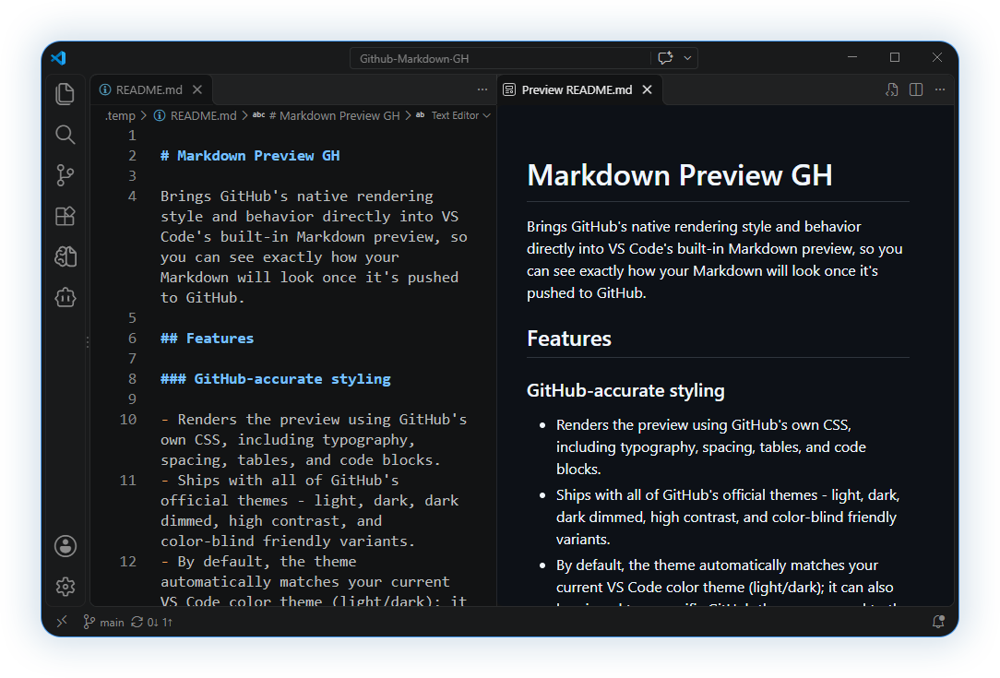
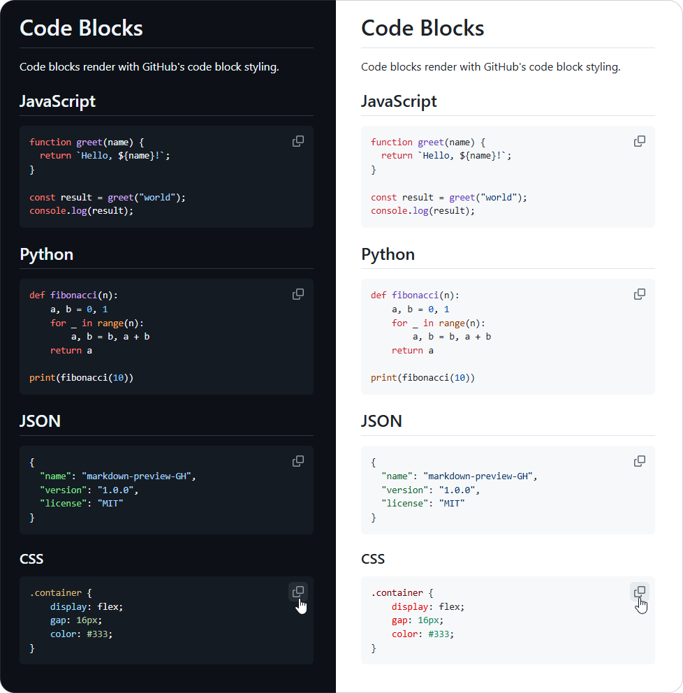
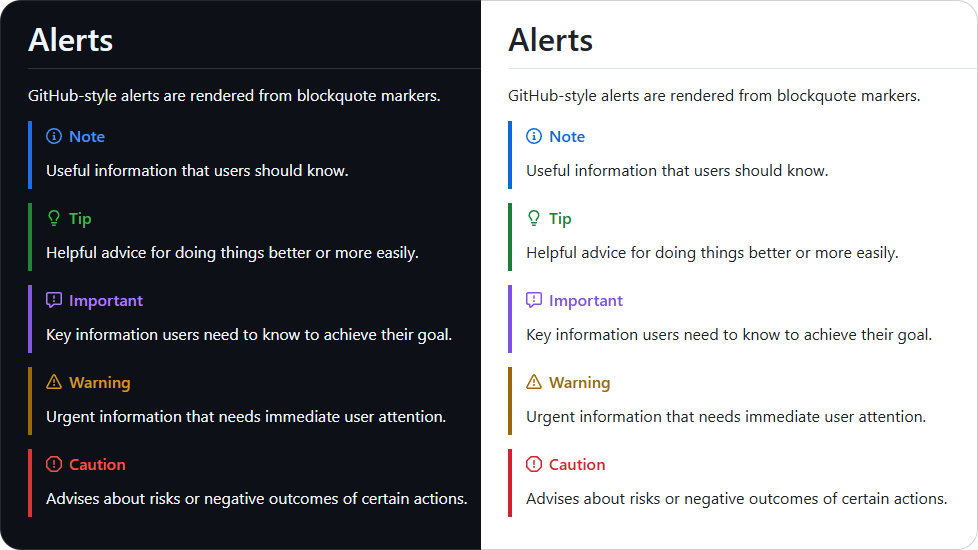
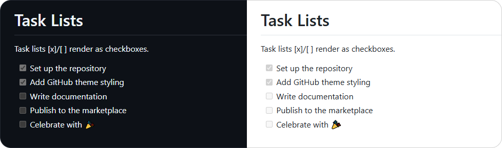
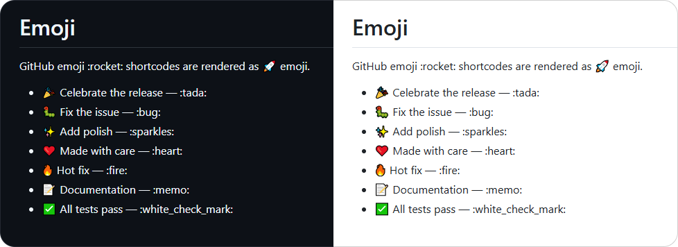
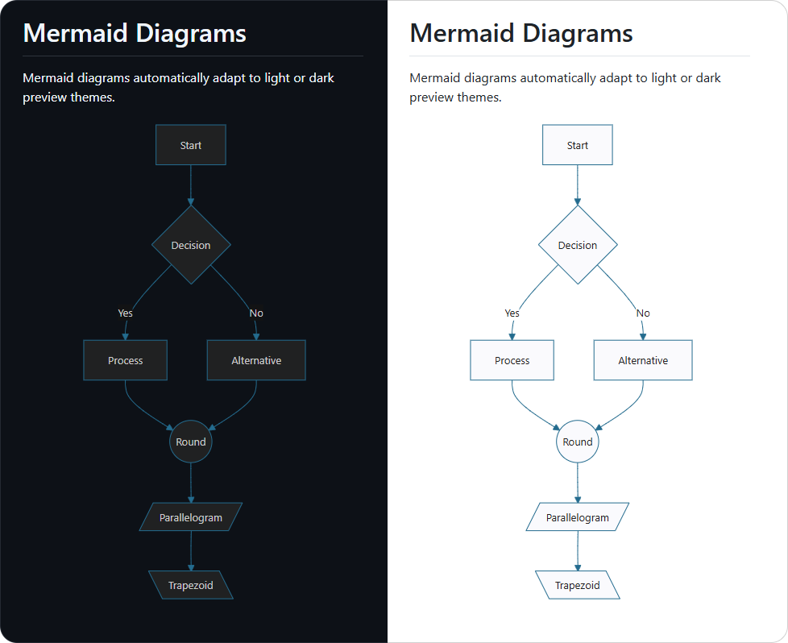
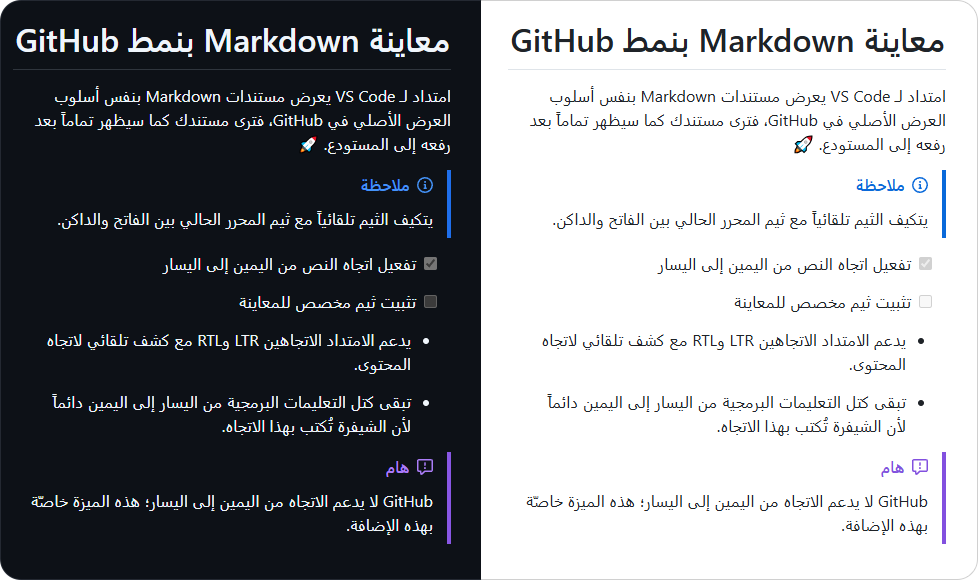
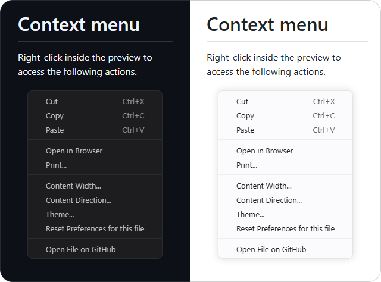
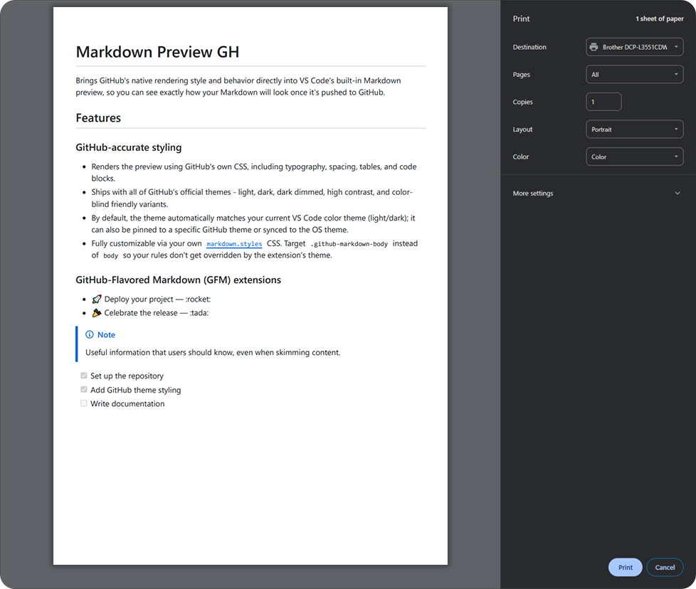

<!-- LOGO_START -->

  

<!-- LOGO_END -->

<h1 align="center">Markdown Preview GH</h1>

A polished Markdown preview for VS Code. It does everything you expect from a preview and adds the details that make reading comfortable: GitHub's familiar look in light and dark, Mermaid diagrams, right-to-left support, and layout settings you can tune for each file.

## Features

### GitHub-style rendering

The preview is drawn with GitHub's own typography, spacing, tables, and code blocks, so your document reads the way it will on GitHub.

- Light and dark themes are built in.
- By default the theme follows your VS Code color theme. You can also pin it to light or dark.
- Your own [`markdown.styles`](https://code.visualstudio.com/Docs/languages/markdown#_using-your-own-css) still apply. Target `.mpgh-body` instead of `body` so your rules are not overridden by the extension's theme.

### Code blocks

Fenced code blocks use GitHub's syntax highlighting and spacing.

### Alerts

`> [!NOTE]`, `[!TIP]`, `[!IMPORTANT]`, `[!WARNING]`, and `[!CAUTION]` blockquotes become colored callout boxes with icons instead of plain quotes.

### Task lists

`- [ ]` and `- [x]` items render as real, read-only checkboxes.

### Emoji shortcodes

`:tada:`, `:rocket:`, `:bug:`, and the rest of GitHub's shortcode set turn into their emoji automatically.

### Mermaid diagrams

Fenced `mermaid` code blocks render as diagrams, ZenUML included. Diagrams follow the preview's theme, so they look right in light, dark, and per-file theme overrides.

### Right-to-left (RTL) support

- Set the content direction to `LTR`, `RTL`, or `Auto`, which detects the direction from the document itself.
- Code blocks always stay left-to-right, because source code is written that way.
- When the direction is RTL, alert titles (Note, Tip, Important, Warning, Caution) appear in Arabic.

### Per-file preferences

Content direction, content width, and theme can be set for a single file without touching your global settings. Right-click inside the preview to reach them:

- **Content Direction...** - choose `LTR`, `RTL`, or `Auto`.
- **Content Width...** - choose `Narrow` (640px), `Normal` (838px, GitHub's own width), `Wide` (1024px), or `Full` (1200px).
- **Theme...** - choose `Light` or `Dark`.
- **Reset Preferences for this file** - clear this file's overrides and return to your global settings.

These choices are remembered for the file in the current workspace, and they never affect other files.

### Open in Browser and Print

- **Open in Browser** - turns the rendered document into a standalone HTML page and opens it in your default browser.
- **Print...** - does the same and opens the browser's print dialog, so you can print the document or save it as PDF.

Both are available from the preview context menu and from the Command Palette while a Markdown file is active. The page follows the theme of your preview, and printing always produces light output. Relative images are resolved against the Markdown file's folder, and the generated page is kept in the extension's storage folder, so nothing is added to your project.

> [!NOTE]
> Mermaid diagrams are drawn inside the exported page itself, so the page is fully self-contained and works offline.

### Export As...

Right-click inside the preview and choose **Export As...** to save the document as a standalone HTML file:

- **HTML Light Theme** - saves the page with the light theme.
- **HTML Dark Theme** - saves the page with the dark theme.

A save dialog asks where to put the file and suggests the Markdown file's name with an `.html` extension. Both commands are also in the Command Palette while a Markdown file is active, and they work in VS Code for the Web.

The exported file is yours to move or share, so it carries only what it can hold itself:

- **Local images are embedded** in the file, so they keep working wherever you move it. An image that is missing, larger than 20 MB, or of an unknown type keeps the path you wrote, and a warning lists it.
- **Internet images stay links.** They load only while you are online.
- **Links are left exactly as you wrote them.** A relative link such as `other.md` cannot know where you will keep the file, so it is not rewritten. The one exception is a link that starts with `//`, which becomes `https://`.

To export without the save dialog, for example from a keybinding or a task, pass the destination in the command argument: `{ "target": "D:/out/page.html" }`. Add `"resource"` with the Markdown file's URI to export a file other than the active one.

### Open File on GitHub

**Open File on GitHub** opens the current file on github.com from the preview context menu. It appears only when the file belongs to a repository with a GitHub remote and git tracks it, so ignored and untracked files never show it.

## Requirements

VS Code 1.106.0 or later.

## Installation

- **From the Marketplace:** install it from the [VS Code Marketplace](https://marketplace.visualstudio.com/items?itemName=Abdulla-Aldosari.markdown-preview-gh), or open the Extensions view in VS Code, search for **Markdown Preview GH**, and select **Install**.
- **From a VSIX file:** run `code --install-extension markdown-preview-gh-<version>.vsix`, or choose **Install from VSIX...** from the Extensions view menu.

## Usage

Open any Markdown file and open VS Code's regular preview with `Ctrl+Shift+V` (`Cmd+Shift+V` on macOS) or `Ctrl+K V` to open it beside the editor. The extension styles that preview automatically; there is nothing to switch on.

Right-click inside the preview for the per-file preferences, export, and GitHub actions described above.

## Commands

| Command                         | Where to find it                      |
| ------------------------------- | ------------------------------------- |
| Content Direction...            | Preview context menu                  |
| Content Width...                | Preview context menu                  |
| Theme...                        | Preview context menu                  |
| Reset Preferences for this file | Preview context menu                  |
| Open in Browser                 | Preview context menu, Command Palette |
| Print...                        | Preview context menu, Command Palette |
| Export As... > HTML Light Theme | Preview context menu, Command Palette |
| Export As... > HTML Dark Theme  | Preview context menu, Command Palette |
| Open File on GitHub             | Preview context menu                  |

Command Palette entries are listed under the **Markdown Preview GH** category.

## Settings

These settings define the global defaults. Per-file preferences (see [Per-file preferences](#per-file-preferences)) always take priority for the files they are set on.

| Setting                                 | Default  | Description                                                                             |
| --------------------------------------- | -------- | --------------------------------------------------------------------------------------- |
| `markdown-preview-gh.colorTheme`        | `auto`   | How the preview picks its theme: `auto` (match the editor), `dark`, or `light`.         |
| `markdown-preview-gh.contentDirection`  | `ltr`    | Content direction: `ltr`, `rtl`, or `auto` (detected from the content).                 |
| `markdown-preview-gh.contentWidth`      | `normal` | Content width: `narrow` (640px), `normal` (838px), `wide` (1024px), or `full` (1200px). |
| `markdown-preview-gh.diagnosticLogging` | `false`  | Writes diagnostic messages to the **Markdown Preview GH** output channel.               |

## Changelog

See [CHANGELOG.md](CHANGELOG.md) for release notes.

## License

Released under the [MIT License](LICENSE).
