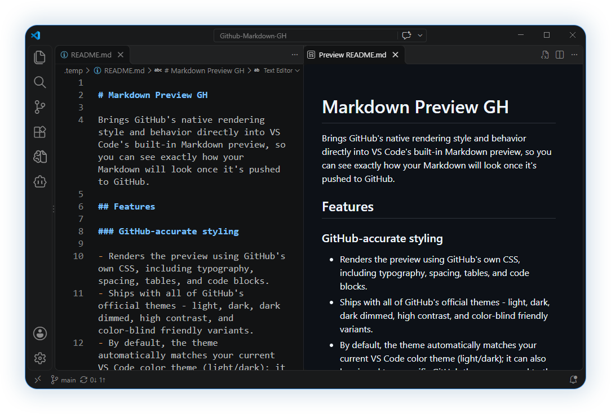
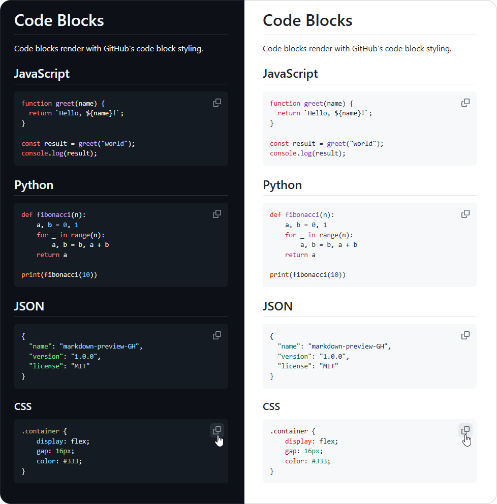
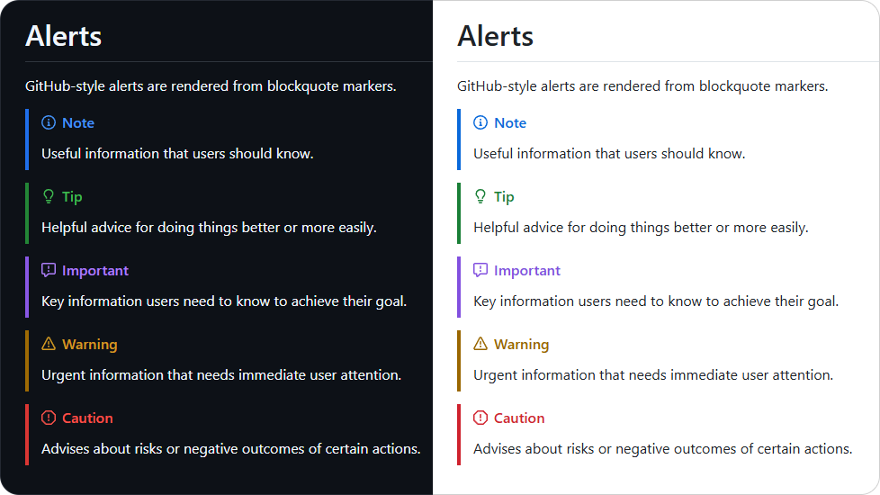
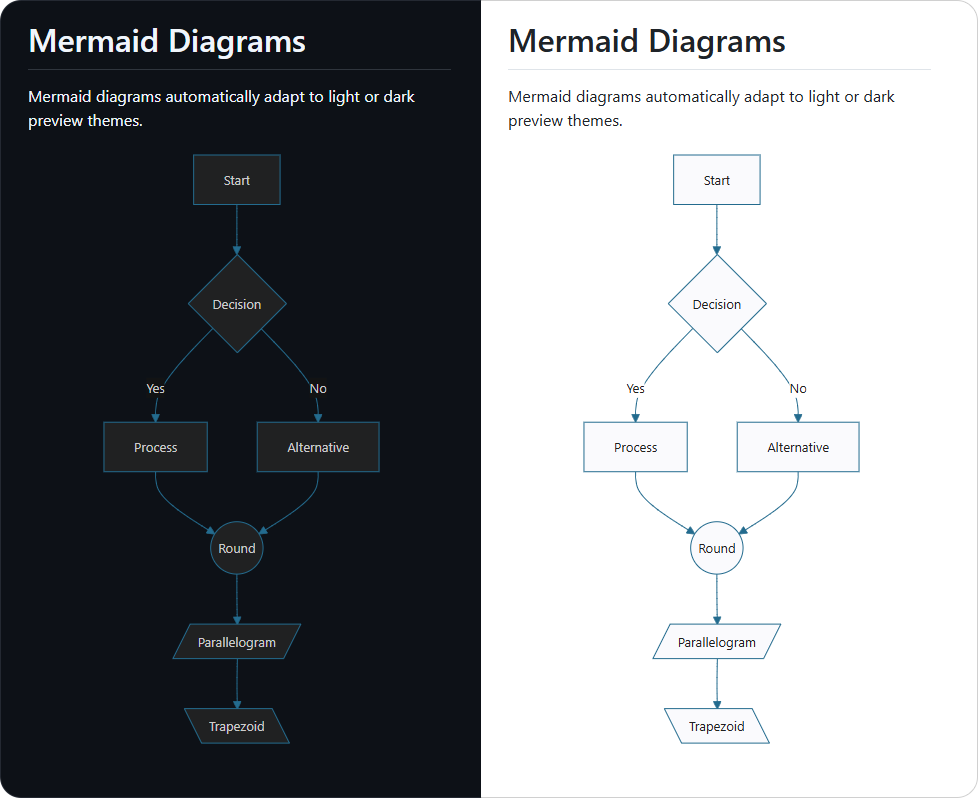
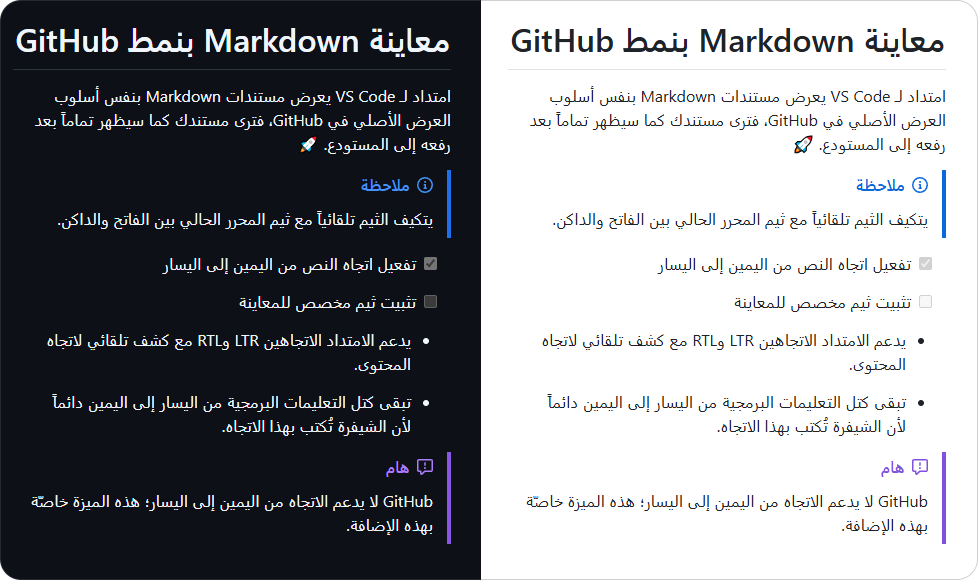
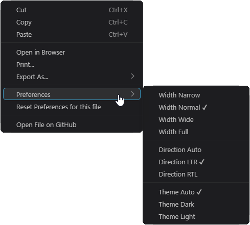
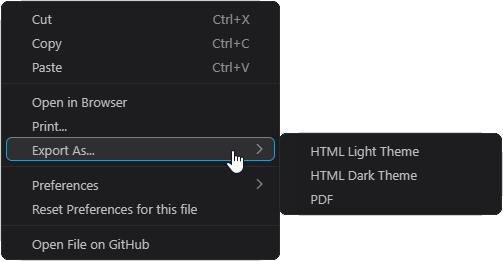

<!-- LOGO_START -->

  

<!-- LOGO_END -->

<h1 align="center">Markdown Preview GH</h1>

  
  

Preview Markdown in VS Code with GitHub's own typography, tables, and code blocks, in light and dark. Add Mermaid diagrams, right-to-left text, per-file layout, copy as PNG, and HTML or PDF export.

## Features

### GitHub-style rendering

The preview is drawn with GitHub's own typography, spacing, tables, and code blocks, so your document reads the way it will on GitHub.

- Light and dark themes are built in. By default the theme follows your VS Code color theme, and you can pin it to light or dark.
- Your own [`markdown.styles`](https://code.visualstudio.com/Docs/languages/markdown#_using-your-own-css) still apply. Target `.mpgh-body` instead of `body` so your rules are not overridden by the extension's theme.

### Code blocks

Fenced code blocks use GitHub's syntax highlighting and spacing. VS Code 1.132 and later add a Copy button to code blocks, and this extension gives it GitHub's look.

---

### Alerts, task lists, and emoji

- `> [!NOTE]`, `[!TIP]`, `[!IMPORTANT]`, `[!WARNING]`, and `[!CAUTION]` blockquotes become colored callout boxes with icons.
- `- [ ]` and `- [x]` items render as read-only checkboxes.
- `:tada:`, `:rocket:`, `:bug:`, and the rest of GitHub's shortcode set turn into their emoji.

---

### Mermaid diagrams

Fenced `mermaid` code blocks render as diagrams, ZenUML included. Diagrams follow the preview's theme, so they look right in light, dark, and per-file theme overrides.

---

### Right-to-left (RTL) support

Set the content direction to `LTR`, `RTL`, or `Auto`, which detects it from the document. Code blocks always stay left-to-right, and when the direction is RTL the alert titles appear in Arabic.

---

### Per-file preferences

Right-click inside the preview and open **Preferences** to set the width, the direction, and the theme for one file, without touching your global settings. A check mark shows the option in effect, and **Reset Preferences for this file** returns the file to your global settings.

  

Details: [Per-file preferences](docs/guide/preferences.md).

---

### Zoom into images and diagrams

Click an image or a Mermaid diagram to open it in a viewer that zooms and pans. Close it with `Esc`. Details: [Image and diagram viewer](docs/guide/image-viewer.md).

---

### Copy as an image

Right-click a heading, a table, a code block, or a diagram and copy it to the clipboard as a PNG, ready to paste into a chat, a document, or an issue.

  

- **Image size.** The image is made at the actual size of the block. If it looks small on your screen, raise the `markdown-preview-gh.blockImageScale` setting.
- **Rounded corners.** The `markdown-preview-gh.blockImageRadius` setting rounds the corners of the PNG (default `10`; `0` keeps square corners).

For more details, see [Copy as an image](docs/guide/copy-as-image.md).

---

### Open in Browser, Print, and Export

- **Open in Browser** and **Print...** turn the rendered document into a standalone page. Printing always produces light output.
- **Export As...** saves the document as **HTML** (light or dark) or as **PDF**. HTML is self-contained: local images are embedded and Mermaid diagrams are drawn inside the page.
- PDF is made by a Chromium-based browser (Edge, Chrome, or Chromium) that is already installed. Nothing is downloaded.

  

Details: [Open in Browser, Print, and Export](docs/guide/export-and-print.md) and [Export without the save dialog](docs/guide/export-without-dialog.md).

---

### Open File on GitHub

Open the current file on github.com from the preview context menu. It appears only when git tracks the file in a repository that has a GitHub remote.

---

## Installation

- **From the Marketplace:** open the Extensions view in VS Code, search for `Markdown Preview GH`, and select **Install**. You can also install it from the [Marketplace page](https://marketplace.visualstudio.com/items?itemName=Abdulla-Aldosari.markdown-preview-gh).
- **From a VSIX file:** run `code --install-extension markdown-preview-gh-<version>.vsix`, or choose **Install from VSIX...** from the Extensions view menu.

Requires VS Code 1.106.0 or later.

## Usage

Open a Markdown file and open VS Code's regular preview with `Ctrl+Shift+V` (`Cmd+Shift+V` on macOS), or `Ctrl+K V` to open it beside the editor. The extension styles that preview automatically; there is nothing to switch on. Right-click inside the preview for everything else.

## Commands

Right-click inside the preview to reach every command. Some are also listed in the Command Palette, under the **Markdown Preview GH** category, while a Markdown file is active.

| Command                         | Where to find it                      |
| ------------------------------- | ------------------------------------- |
| Preferences                     | Preview context menu                  |
| Reset Preferences for this file | Preview context menu                  |
| Open in Browser                 | Preview context menu, Command Palette |
| Print...                        | Preview context menu, Command Palette |
| Export As... > HTML Light Theme | Preview context menu, Command Palette |
| Export As... > HTML Dark Theme  | Preview context menu, Command Palette |
| Export As... > PDF              | Preview context menu, Command Palette |
| Open File on GitHub             | Preview context menu                  |
| Copy This Section As PNG        | Preview context menu                  |
| Copy This Table As PNG          | Preview context menu                  |
| Copy This Code Block As PNG     | Preview context menu                  |
| Copy This Diagram As PNG        | Preview context menu                  |

## Settings

These settings define the global defaults. Per-file preferences always take priority for the files they are set on.

| Setting                                  | Default  | Description                                                                                              |
| ---------------------------------------- | :------: | -------------------------------------------------------------------------------------------------------- |
| `markdown-preview-gh.colorTheme`         |  `auto`  | How the preview picks its theme: `auto` (match the editor), `dark`, or `light`.                          |
| `markdown-preview-gh.contentDirection`   |  `ltr`   | Content direction: `ltr`, `rtl`, or `auto` (detected from the content).                                  |
| `markdown-preview-gh.contentWidth`       | `normal` | Content width: `narrow` (640px), `normal` (838px), `wide` (1024px), or `full` (1200px).                  |
| `markdown-preview-gh.diagnosticLogging`  | `false`  | Writes diagnostic messages to the **Markdown Preview GH** output channel.                                |
| `markdown-preview-gh.export.browserPath` |  empty   | Full path of the Chromium-based browser used by **Export As... > PDF**. Empty detects one automatically. |
| `markdown-preview-gh.blockImageScale`    |   `1`    | Scale of the PNG made by **Copy This ... As PNG**: `1` (actual size), `1.5`, `2`, `2.5`, or `3`.         |
| `markdown-preview-gh.blockImageRadius`   |   `10`   | Corner radius of the PNG made by **Copy This ... As PNG**: `0` (square) to `16`, in pixels.              |

## Where each feature works

| Feature                                                             | Desktop | Remote window (WSL, SSH, Dev Containers) | VS Code for the Web |
| ------------------------------------------------------------------- | :-----: | ---------------------------------------- | ------------------- |
| Open in Browser, Print... |   Yes   | Yes                                      | No                  |
| Export As... > HTML                                                 |   Yes   | Yes                                      | Yes                 |
| Export As... > PDF                                                  |   Yes   | Yes                                      | No                  |
| Open File on GitHub                                                 |   Yes   | Yes                                      | No                  |
| Copy This ... As PNG                                                |   Yes   | Yes                                      | Yes                 |

- **`Export As... > PDF`** needs a Chromium-based browser (Microsoft Edge, Google Chrome, or Chromium) on the machine where the extension runs. In a remote window that is the remote machine, not your local computer.

- In a Dev Container, **`Export As... > PDF`** also needs [one container setting](docs/guide/troubleshooting.md#the-browser-exits-in-a-dev-container) that lets the browser start its sandbox.

## Troubleshooting

A command is missing, a copy fails, or no browser is found for PDF? See [Troubleshooting](docs/guide/troubleshooting.md). To report a problem or suggest an idea, open an [issue](https://github.com/Abdulla-Aldosari/Markdown-Preview-GH/issues).

## Contributing

See [CONTRIBUTING.md](CONTRIBUTING.md).

## Changelog

See [CHANGELOG.md](CHANGELOG.md) for release notes.

## License

Released under the [MIT License](LICENSE).
