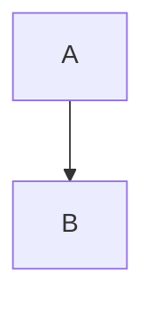

# Markdown Surface

This document is the HTML surface the theme audit classifies against. It is
rendered to HTML (by VS Code's preview, or by markdown-it as a fallback) and
every tag, class, and attribute in the result becomes the set of selectors a
changed CSS rule is checked against. Keep it broad: each construct below
should represent something that can appear in a real Markdown preview.

## Headings

# Heading 1

## Heading 2

### Heading 3

#### Heading 4

##### Heading 5

###### Heading 6

Setext Heading 1
================

Setext Heading 2
----------------

## Emphasis and inline markup

A paragraph with **bold**, _italic_, _**bold italic**_, ~~strikethrough~~,
`inline code`, [a link](https://example.com 'A title'), a bare autolink
https://example.com, an angle autolink <https://example.com>, an email
<user@example.com>, an image , a keyboard
<kbd>Ctrl</kbd>, <mark>marked</mark>, <ins>inserted</ins>, <del>deleted</del>,
<sup>superscript</sup> and <sub>subscript</sub>, plus emoji :smile: :tada:.

Inline raw HTML: <b>bold</b>, <i>italic</i>, <u>underline</u>,
<dfn>definition</dfn>, <samp>sample</samp>, <small>small</small>,
<abbr title="Cascading Style Sheets">CSS</abbr>, <tt>teletype</tt>,
<var>variable</var>, <cite>citation</cite>, <q>quote</q>, and a<wbr>break.

An anchor without an href: <a>plain anchor</a>. A forced<br>line break.

Escaped characters: \*not italic\*, \_not italic\_, \`not code\`,
\> not a quote, \# not a heading.

## Links and images

Inline: [link](https://example.com), [link with title](https://example.com 'Title').

Reference: [full][ref], collapsed [collapsed][], and shortcut [shortcut].

[ref]: https://example.com/full
[collapsed]: https://example.com/collapsed
[shortcut]: https://example.com/shortcut

A reference image: ![reference image][img].

[img]: https://example.com/image.png

## Blockquotes and alerts

> A blockquote with **bold** and `code`.

> A nested quote:
>
> > inner.

> A quote that contains a list:
>
> - item one
> - item two

> [!NOTE]
> A note.

> [!TIP]
> A tip.

> [!IMPORTANT]
> An important note.

> [!WARNING]
> A warning.

> [!CAUTION]
> A caution.

## Lists

- Unordered item
    - Nested item
        - Nested item
- Second item

* Alternative bullet marker

- Plus bullet marker

1. Ordered item
2. Second item
    1. Nested ordered
    2. Nested ordered
        1. Nested ordered

1) Parenthesized ordered marker

- [ ] Unchecked task
- [x] Checked task

1. [ ] Ordered unchecked
2. [x] Ordered checked

## Block-level HTML

A definition list:

<dl>
  <dt>Term</dt>
  <dd>Definition</dd>
  <dt>Second term</dt>
  <dd>Second definition</dd>
</dl>

A figure:

<figure>
  
  <figcaption>A caption.</figcaption>
</figure>

Ordered lists with an explicit type:

<ol type="a">
  <li>lower-alpha</li>
</ol>

<ol type="A">
  <li>upper-alpha</li>
</ol>

<ol type="i">
  <li>lower-roman</li>
</ol>

<ol type="I">
  <li>upper-roman</li>
</ol>

## Images and alignment

GitHub-style image alignment spans:

<span class="frame"></span>

<span class="align-center"></span>

<span class="align-right"></span>

<span class="float-left"></span>

<span class="float-right"></span>

Aligned images:  and
.

## Emoji

GitHub emoji elements:

<g-emoji class="g-emoji" alias="smile">😄</g-emoji>
<g-emoji class="g-emoji" alias="tada">🎉</g-emoji>

An emoji span: <span class="emoji">😄</span>

## Code blocks

A fenced block with a language:

```js
const answer = 42;
console.log(answer);
```

Fenced blocks with symbolic language names:

```c++
#include <iostream>
```

```c#
Console.WriteLine("hi");
```

A fenced block without a language:

```
plain text
```

An indented code block:

    indented code

## Tables

| Left | Center | Right |
| :--- | :----: | ----: |
| a    |   b    |     c |
| d    |   e    |     f |

A table with an escaped pipe and inline code:

| Column | Value |
| ------ | ----- |
| pipe   | \|    |
| code   | `x`   |

## Form controls

<input type="submit" value="Submit" />
<input type="radio" name="choice" /> Radio
<input type="checkbox" /> Checkbox
<input type="number" />
<input type="search" />
<input type="date" />
<input type="text" />

## Details, footnotes, and rules

<details>
<summary>A summary</summary>
Hidden details.
</details>

A footnote reference.[^1]

[^1]: The footnote text.

---

## Raw HTML elements

<div>A raw div.</div>

<span>A raw span.</span>

<svg width="60" height="60"><circle cx="30" cy="30" r="30" /></svg>

Inline <em>raw em</em> and <strong>raw strong</strong>.

A GitHub-style CSV data table:

<table class="csv-data">
<thead>
<tr><th class="blob-num">1</th><th>name</th><th>value</th></tr>
</thead>
<tbody>
<tr><td class="blob-num">2</td><td>alpha</td><td>1</td></tr>
</tbody>
</table>

An HTML comment:

<!-- an HTML comment -->

## Mermaid


