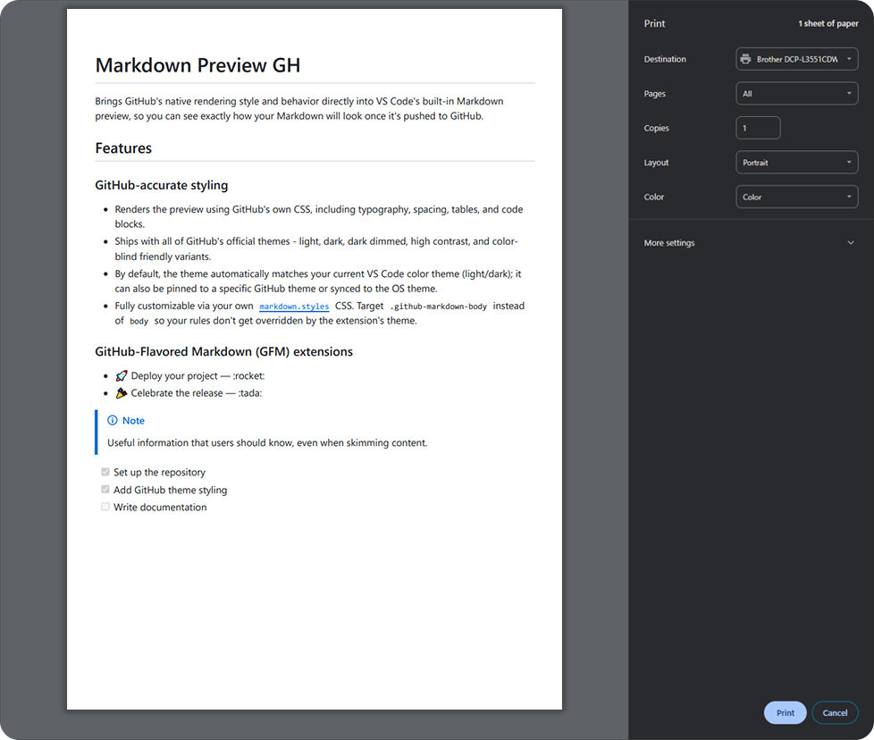
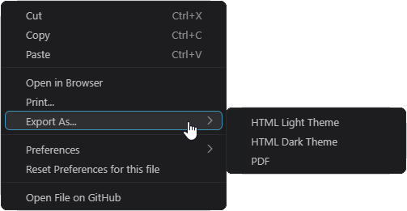

# Open in Browser, Print, and Export

## Open in Browser and Print

- **Open in Browser** - turns the rendered document into a standalone HTML page and opens it in your default browser.
- **Print...** - does the same and opens the browser's print dialog, so you can print the document or save it as PDF.

A progress notification shows while the page is prepared, and a second click on the same document during that time is ignored. In a remote window (WSL, SSH, Dev Containers) the page is served from the remote machine for a short time and opened through VS Code's port forwarding; local images are embedded and links are left as you wrote them.

Both are available from the preview context menu and from the Command Palette while a Markdown file is active. The page follows the theme of your preview, and printing always produces light output. Relative images are resolved against the Markdown file's folder, and the generated page is kept in the extension's storage folder, so nothing is added to your project.

<!--Auto-Stripping-By-DevDeck-During-The-Publishing-Process-For-Marketplace--[!NOTE]-not-supported-->

> [!NOTE]
> Mermaid diagrams are drawn inside the exported page itself, so the page is fully self-contained and works offline.

## Export As...

Right-click inside the preview and choose **Export As...** to save the document as a standalone HTML file or as a PDF:

- **HTML Light Theme** - saves the page with the light theme.
- **HTML Dark Theme** - saves the page with the dark theme.
- **PDF** - saves the document as a PDF file. It is available in desktop VS Code only, and it needs a Chromium-based browser (see [Export As PDF](#export-as-pdf)).

  

A save dialog asks where to put the file and suggests the Markdown file's name with an `.html` extension. Both commands are also in the Command Palette while a Markdown file is active, and they work in VS Code for the Web. When the file is written, a message shows where it was saved, with an **Open File** button that opens it in your browser (in a remote window the message has no button, because the file is on the remote machine).

The exported file is yours to move or share, so it carries only what it can hold itself:

- **Local images are embedded** in the file, so they keep working wherever you move it. An image that is missing, larger than 20 MB, or of an unknown type keeps the path you wrote.
- **Internet images stay links.** They load only while you are online.
- **Links are left exactly as you wrote them.** A relative link such as `other.md` cannot know where you will keep the file, so it is not rewritten. The one exception is a link that starts with `//`, which becomes `https://`.

To skip the save dialog, see [Export without the save dialog](export-without-dialog.md).

## Export As PDF

**PDF** prints the document with a Chromium-based browser (Microsoft Edge, Google Chrome, or Chromium) that is already installed on your computer. The extension starts the browser in the background, prints the page, and closes it, so nothing is downloaded and no browser window opens.

- **The page is always light**, like `Print...`, so a dark preview still gives a PDF with dark text on a white page.
- **Local images are embedded, internet images stay links, and links are left as you wrote them**, the same as the HTML export. Mermaid diagrams are drawn before the page is printed.
- **A progress notification shows while the file is made**, and you can cancel it. A cancelled export writes nothing. When the file is written, a message shows where it was saved.
- **The browser is detected automatically.** To use a specific one, set `markdown-preview-gh.export.browserPath` (see [Settings](../../README.md#settings)).
- **It is not available in VS Code for the Web**, because a web page cannot start a browser on your computer. Use the HTML export there.
- **In a remote window (WSL, SSH, Dev Containers)** the browser is looked up on the remote machine, not on your local computer.

If no browser is found, a message explains where the search ran and offers buttons: **Open Settings**, **Export as HTML instead**, and **Open in Browser (then Save as PDF)**.
