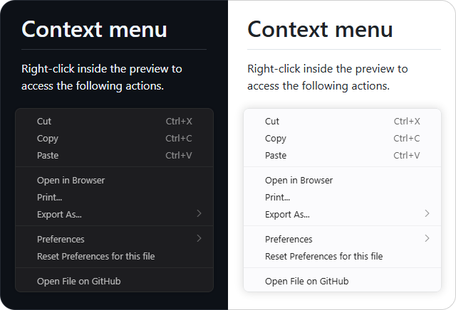
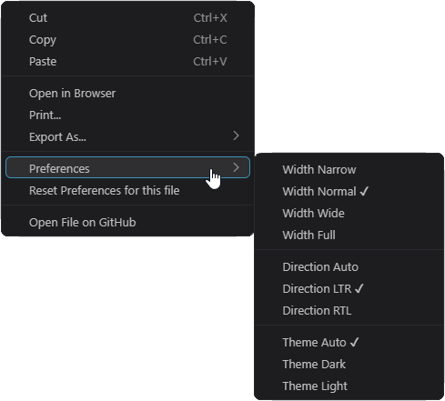

# Per-file preferences

Content direction, content width, and theme can be set for a single file without touching your global settings. Right-click inside the preview to reach them:

  

- **Preferences** - a submenu that lists every option in three groups, with a check mark (✔) beside the option in effect for this file:
    - **Width** - `Narrow` (640px), `Normal` (838px, GitHub's own width), `Wide` (1024px), or `Full` (1200px).
    - **Direction** - `Auto` (detected from the content), `LTR`, or `RTL`.
    - **Theme** - `Auto` (follow the editor's light or dark theme, even when your global theme setting is pinned), `Dark`, or `Light`.
- **Reset Preferences for this file** - clear this file's overrides and return to your global settings.

  

<!--Auto-Stripping-By-DevDeck-During-The-Publishing-Process-For-Marketplace--[!NOTE]-not-supported-->

> [!NOTE]
> These choices are remembered for the file in the current workspace, and they never affect other files.
