# Mermaid Theme Audit

## 01 - flowchart

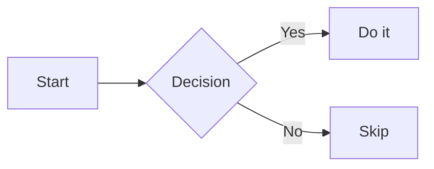

## 02 - sequenceDiagram

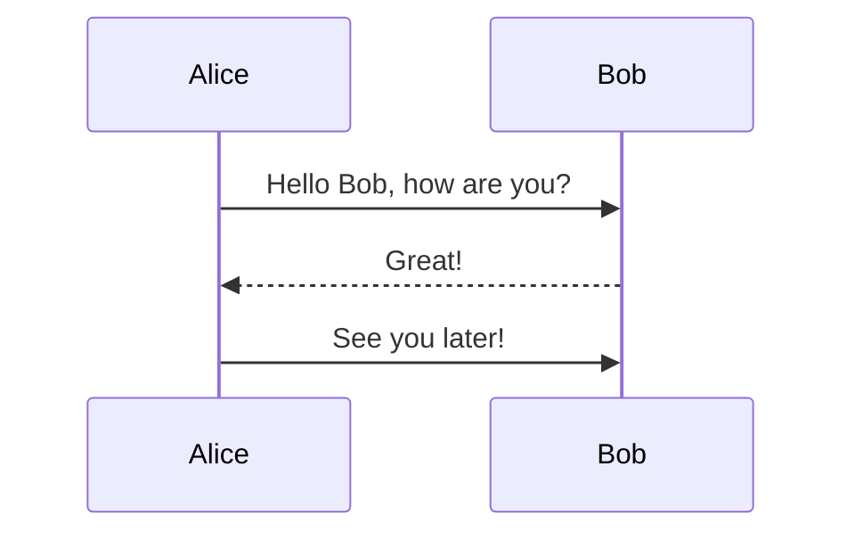

## 03 - classDiagram

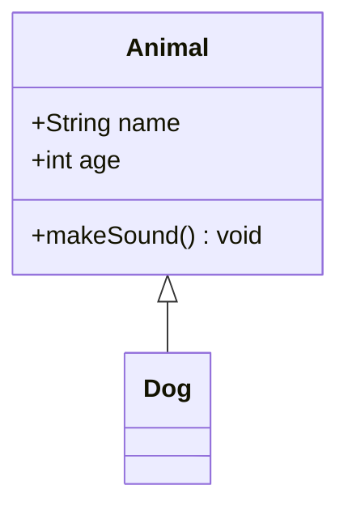

## 04 - stateDiagram

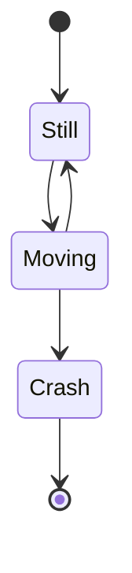

## 05 - erDiagram

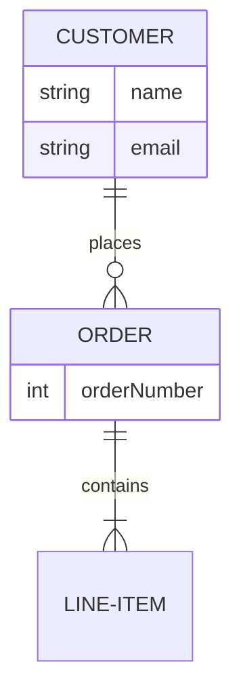

## 06 - gitGraph

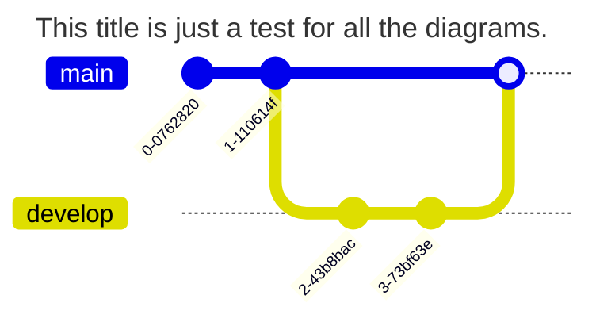

## 07 - pie

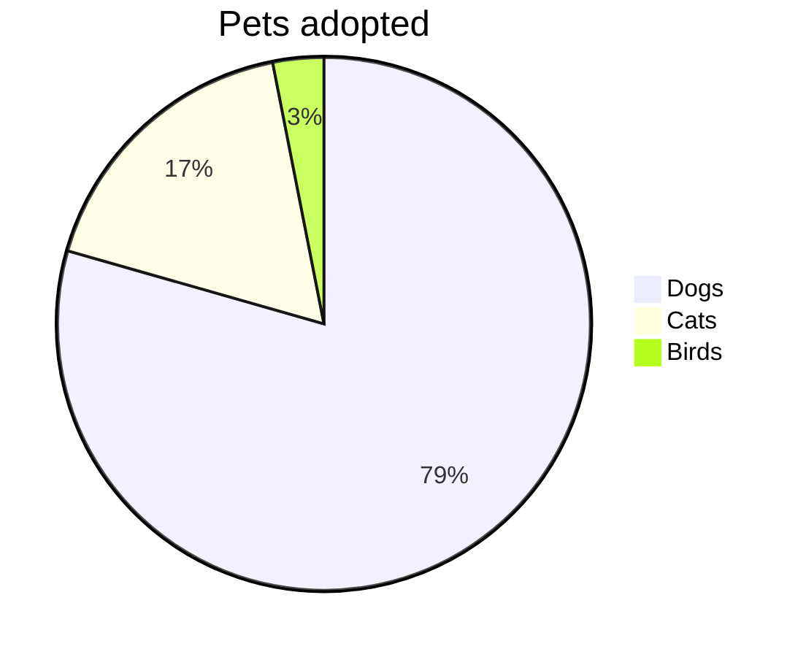

## 08 - quadrantChart

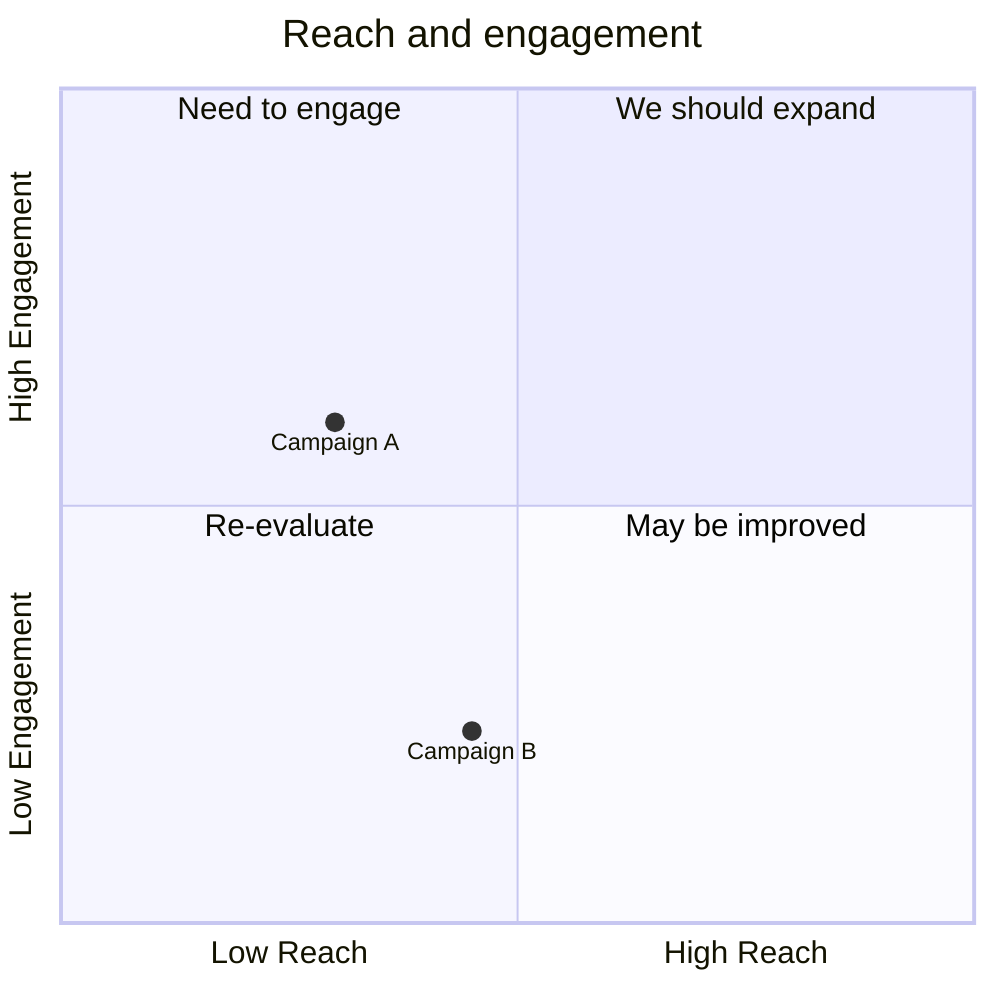

## 09 - requirementDiagram

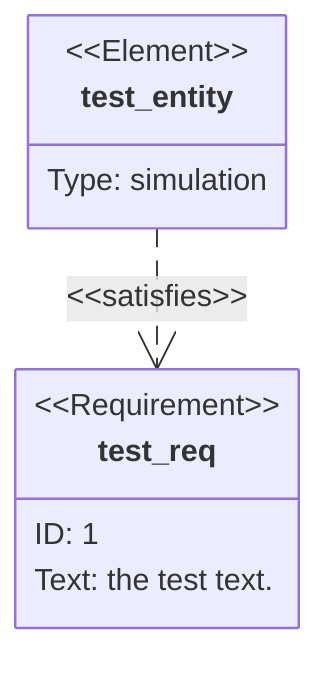

## 10 - gantt

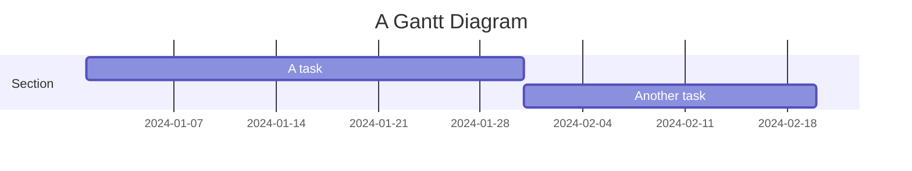

## 11 - journey

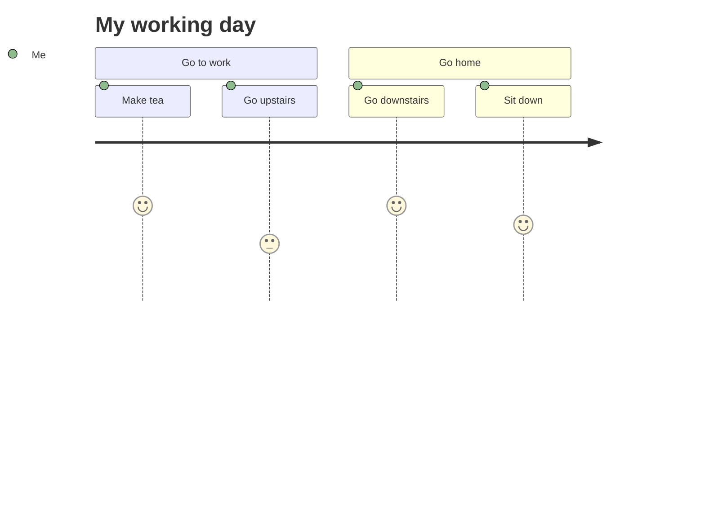

## 12 - mindmap

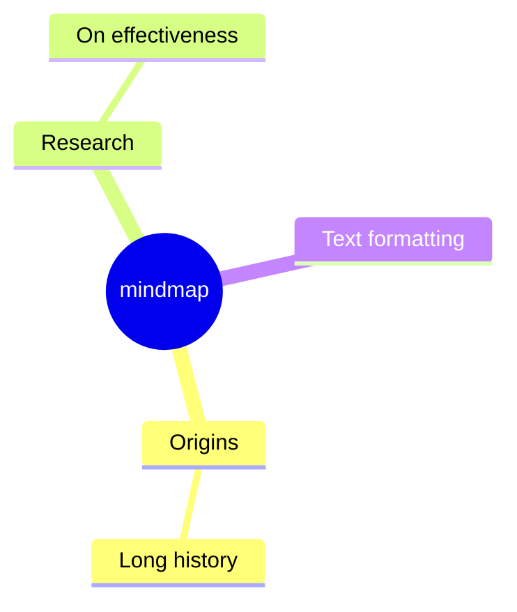

## 13 - timeline

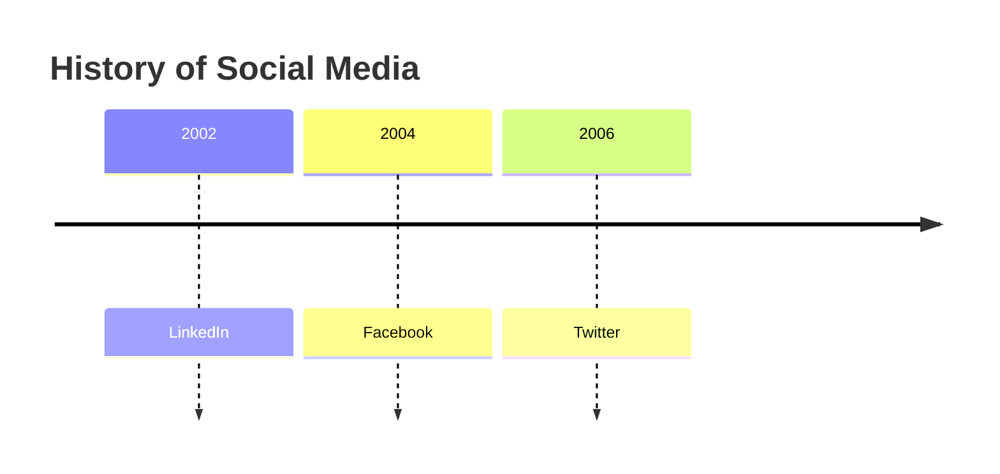

## 14 - sankey

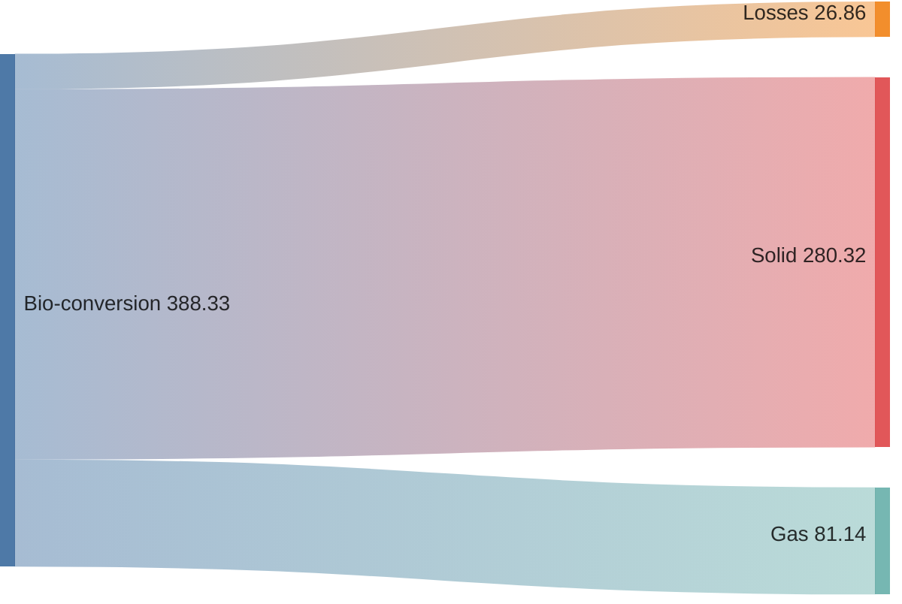

## 15 - xyChart

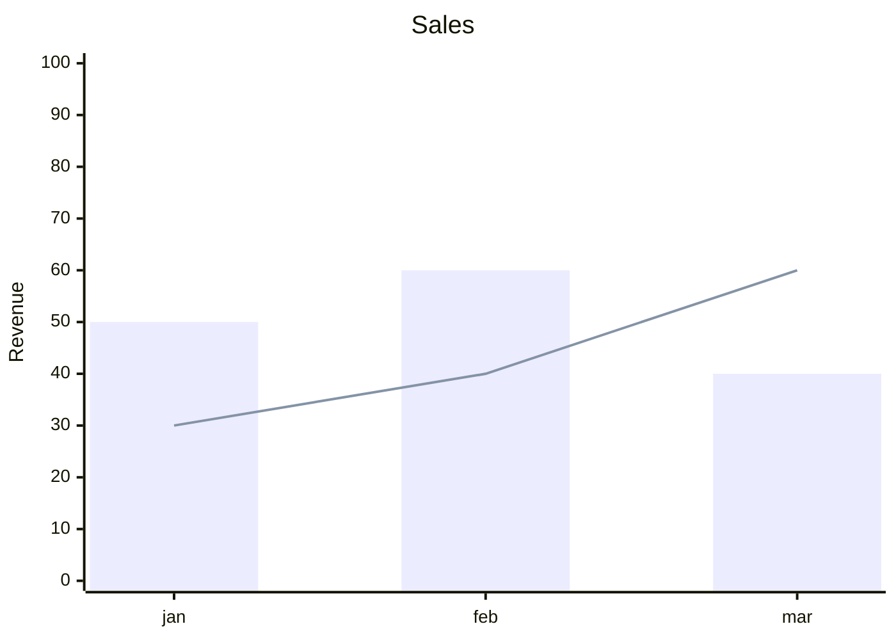

## 16 - block

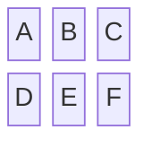

## 17 - packet

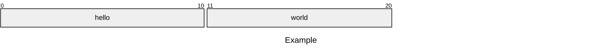

## 18 - kanban

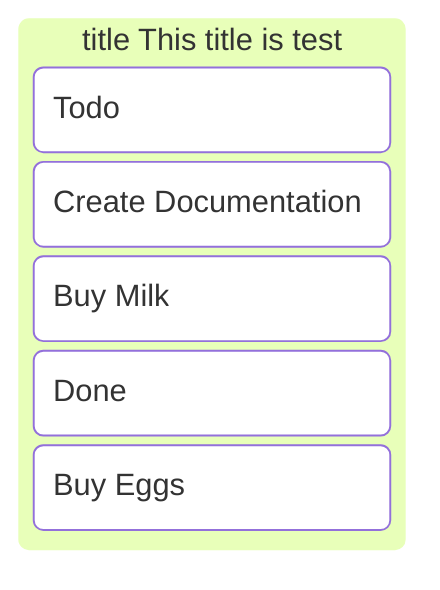

## 19 - architecture

```mermaid
architecture-beta
    group api(logical)[API]
    service db(database)[Database] in api
    service web(server)[Web Server] in api
    db:R --> L:web
```

## 20 - venn

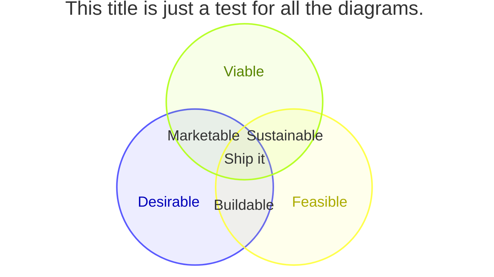

vvvvvvvv

## 21 - swimlane

```mermaid
swimlane-beta
A[Service] --> B[Database]
C[Client] --> A
```

## 22 - treeView

```mermaid
treeView-beta
  src
    index.ts
    utils
      helper.ts
      format.ts
```

## 23 - c4

```mermaid
C4Context
  title System Context
  Person(customer, "Customer")
  System(system, "System")
  Rel(customer, system, "Uses")
```

vvvvvv

## 24 - ishikawa

```mermaid
ishikawa-beta
root Main Problem
cause Problem 1
cause Problem 2
```

## 25 - radar1

```mermaid
radar-beta
  title Restaurant Comparison
  axis food["Food Quality"], service["Service"], price["Price"]
  axis ambiance["Ambiance"]

  curve a["Restaurant A"]{4, 3, 2, 4}
  curve b["Restaurant B"]{3, 4, 3, 3}
  curve c["Restaurant C"]{2, 3, 4, 2}
  curve d["Restaurant D"]{2, 2, 4, 3}

  graticule polygon
  max 5
```

## 26 - radar2

```mermaid
---
config:
  radar:
    axisScaleFactor: 0.25
    curveTension: 0.1
  theme: base
  themeVariables:
    radar:
      curveOpacity: 0
---
radar-beta
title This title is just a test for all the diagrams
  axis A, B, C, D, E
  curve c1{1,2,3,4,5}
  curve c2{5,4,3,2,1}
  curve c3{3,3,3,3,3}

```

## 27 - treemap

```mermaid
treemap-beta
title This title is just a test for all the diagrams.
"Products"
    "Electronics"
        "Phones": 50
        "Computers": 30
        "Accessories": 20
    "Clothing"
        "Men's": 40
        "Women's": 40
```

## 28 - Cynefin

```mermaid
cynefin-beta
  title Incident Response

  complex
    "Investigate root cause"
    "Run chaos experiment"

  complicated
    "Analyze performance data"
    "Expert review needed"

  clear
    "Restart service"
    "Apply known fix"

  chaotic
    "Page on-call immediately"

  confusion
    "Unknown failure mode"
```

## 29 - zenuml

```mermaid
---
config:
  theme: redux-dark-color
---
zenuml
    title Reply message
    Client->A.method() {
      B.method() {
        if(condition) {
          return x1
          // return early
          @return
          A->Client: x11
        }
      }
      return x2
    }
```

## 30 - wardley

```mermaid

wardley-beta
title Forces

component Legacy [0.20, 0.85]
component Modern [0.55, 0.60]
component AI [0.70, 0.35]

Legacy -> Modern
Modern -> AI

accelerator "AI Adoption" [0.55, 0.25]
deaccelerator "Legacy Constraints" [0.15, 0.75]

```
