# Mermaid Theme Audit

## flowchart

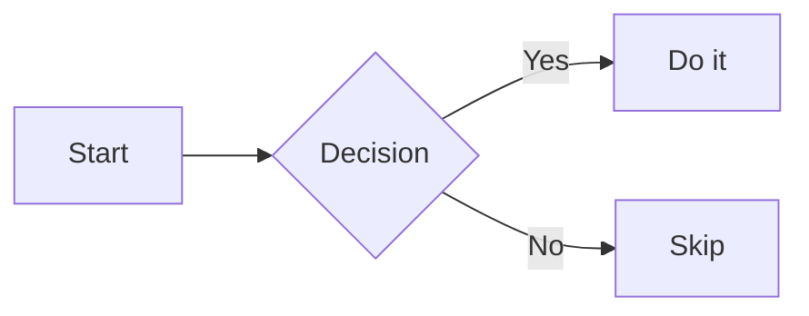

## sequenceDiagram

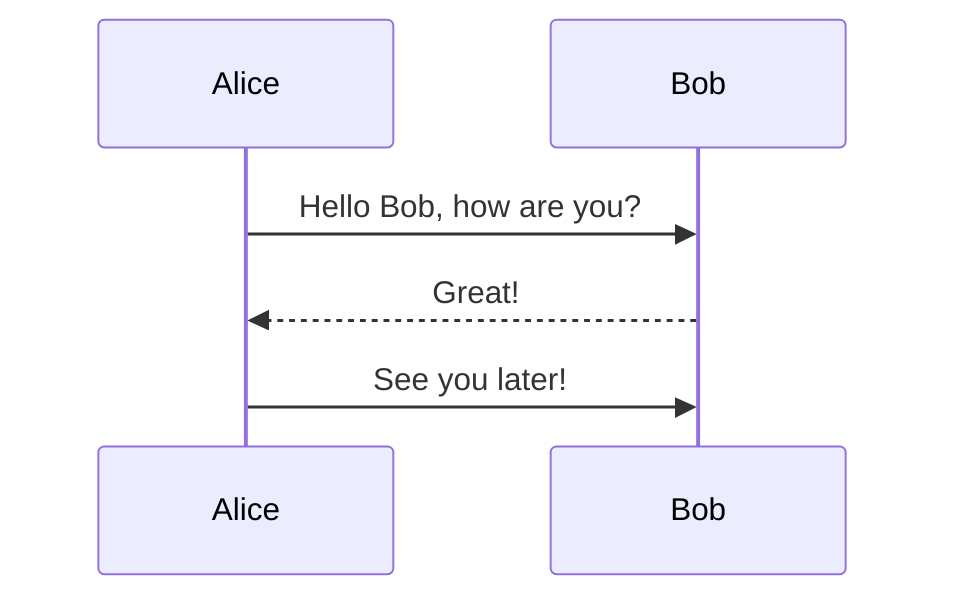

## classDiagram

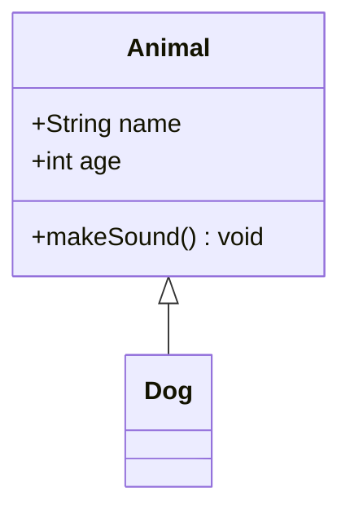

## stateDiagram

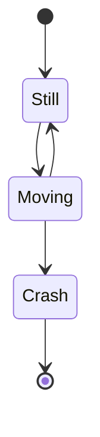

## erDiagram

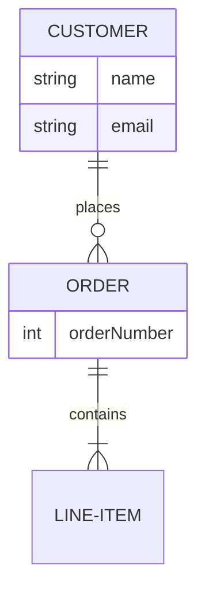

## gitGraph

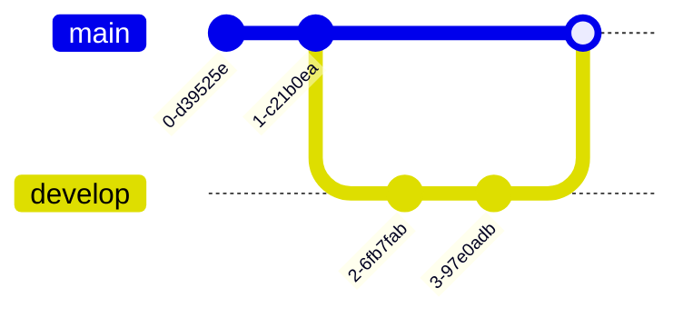

## pie

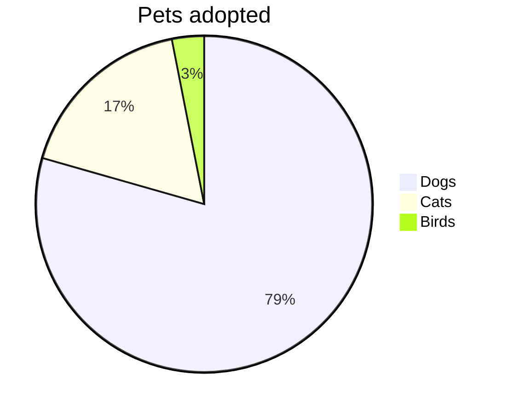

## quadrantChart

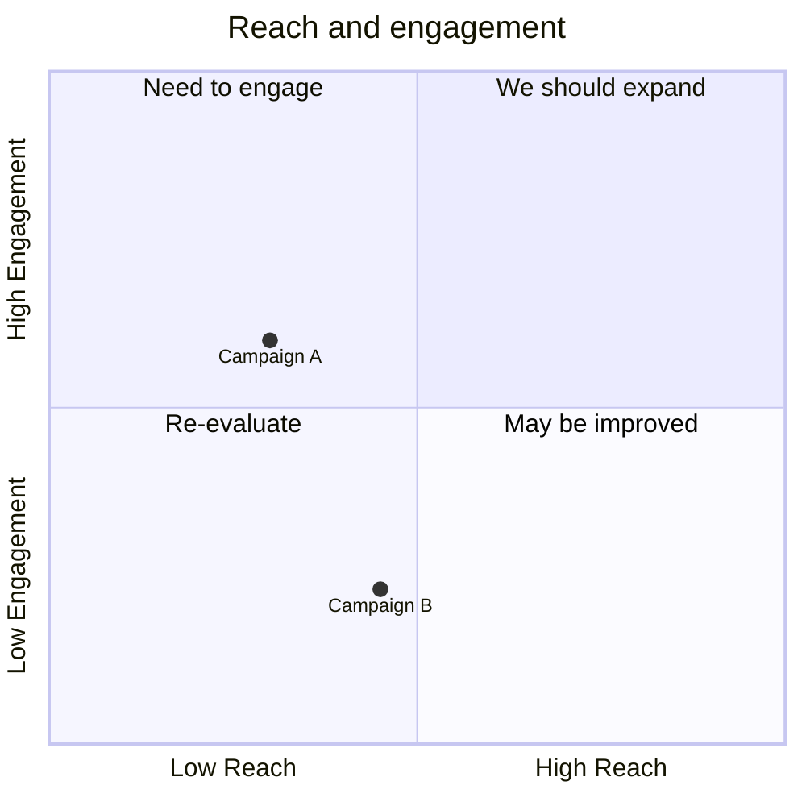

## requirementDiagram

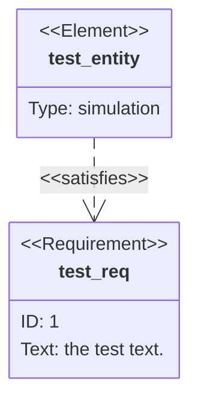

## gantt

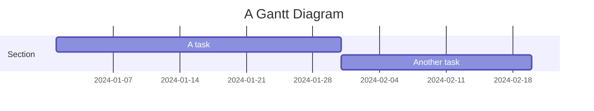

## journey

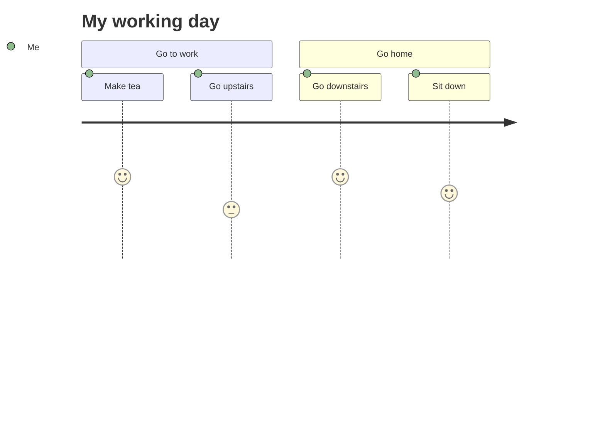

## mindmap

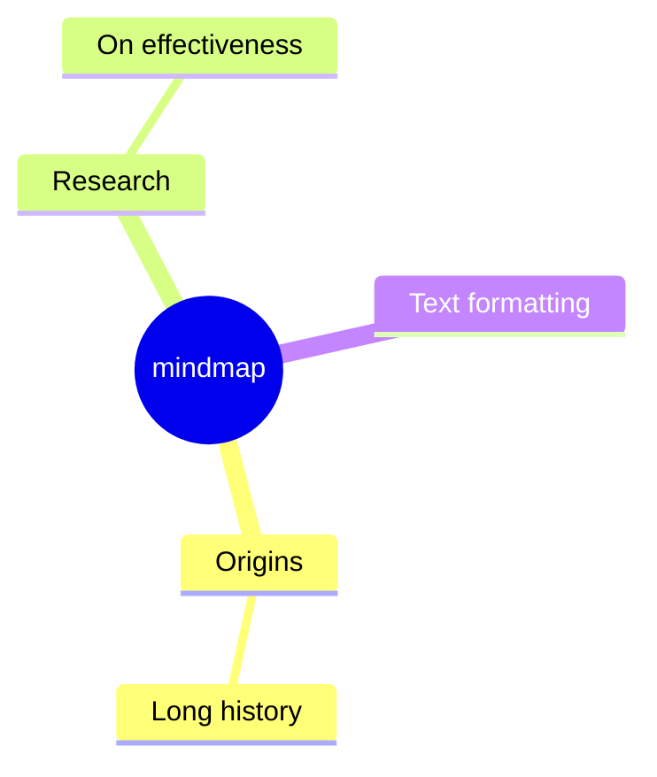

## timeline

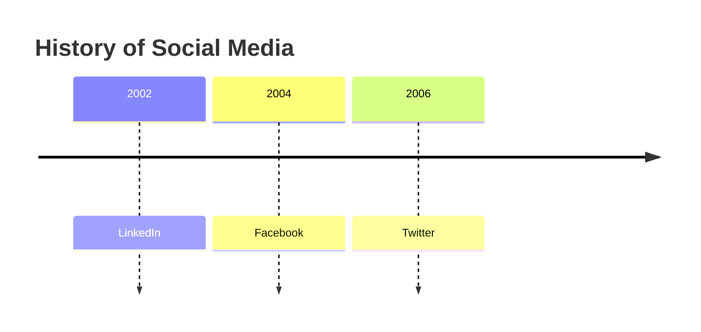

## sankey

```mermaid
sankey-beta
  A, B : 30
  A, C : 70
```

## xyChart

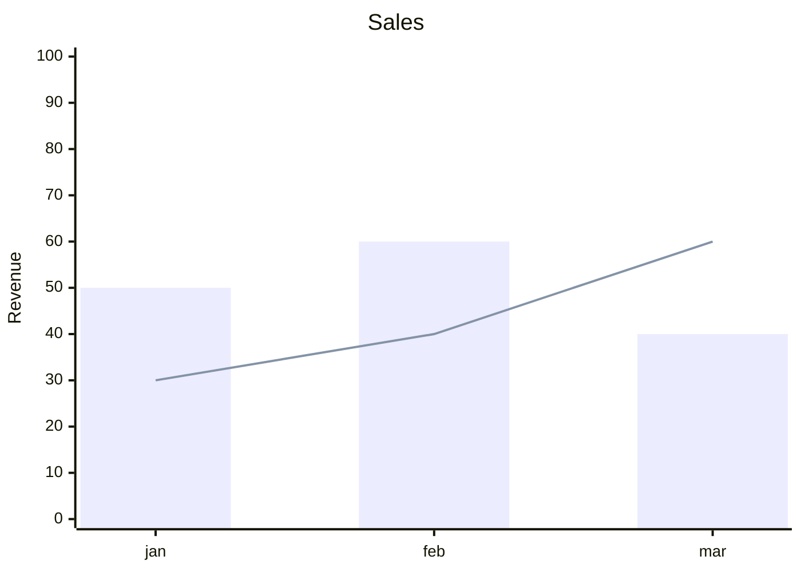

## block

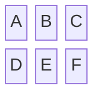

## packet

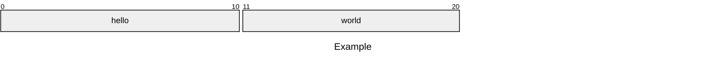

## kanban

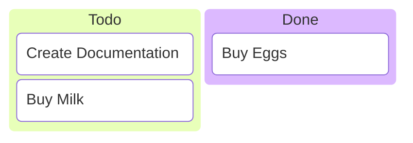

## architecture

```mermaid
architecture-beta
    group api(logical)[API]
    service db(database)[Database] in api
    service web(server)[Web Server] in api
    db:R --> L:web
```

## radar

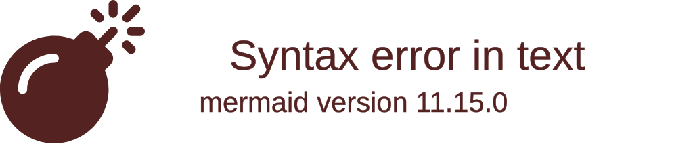

## treemap

```mermaid
treemap-beta
  Market
    TSLA 100
    AAPL 500
```

## venn

```mermaid
venn-beta
  set Desirable
  set Feasible
  set Viable
  union Desirable,Feasible["Buildable"]
  union Feasible,Viable["Sustainable"]
  union Desirable,Viable["Marketable"]
  union Desirable,Feasible,Viable["Ship it"]
```

## swimlane

```mermaid
swimlane-beta
A[Service] --> B[Database]
C[Client] --> A
```

## treeView

```mermaid
treeView-beta
  src
    index.ts
    utils
      helper.ts
      format.ts
```

## c4

```mermaid
C4Context
  title System Context
  Person(customer, "Customer")
  System(system, "System")
  Rel(customer, system, "Uses")
```

## zenuml

```mermaid
zenuml
  A->B: request
  B->A: response
```

## ishikawa

```mermaid
ishikawa-beta
root Main Problem
cause Problem 1
cause Problem 2
```

## cynefin

```mermaid
cynefin-beta
title Example
n-1[Complex]
n-2[Complicated]
```

## wardley

```mermaid
wardley
anchor Customer[0.9, 0.1]
component A[0.5, 0.5]
```

## eventmodeling

```mermaid
eventmodeling
Customer -> Website[1]
```
