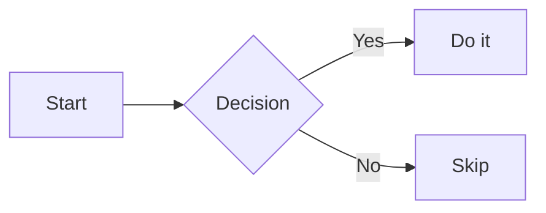

# Fidelity Fixture

## Tall Table Section

| Name  | Role     | Notes                  | Score | Team | City     |
| ----- | -------- | ---------------------- | ----- | ---- | -------- |
| Alice | Engineer | Writes the parser      | 91    | Core | Riyadh   |
| Bob   | Designer | Draws the icons        | 84    | UI   | Jeddah   |
| Carol | Tester   | Breaks everything      | 77    | QA   | Dammam   |
| Dave  | Manager  | Plans the releases     | 88    | Core | Mecca    |
| Erin  | Writer   | Documents the commands | 93    | Docs | Medina   |
| Frank | Engineer | Fixes the build        | 69    | Core | Tabuk    |
| Grace | Analyst  | Reads the logs         | 81    | Data | Abha     |
| Heidi | Support  | Answers the questions  | 74    | Help | Taif     |
| Ivan  | Engineer | Tunes the cache        | 90    | Core | Hail     |
| Judy  | Designer | Picks the colors       | 86    | UI   | Jazan    |
| Karl  | Tester   | Automates the checks   | 79    | QA   | Najran   |
| Laura | Engineer | Ships the extension    | 95    | Core | Buraidah |

## Wide Table Section

| VeryLongUnbreakableHeaderNumber1 | VeryLongUnbreakableHeaderNumber2 | VeryLongUnbreakableHeaderNumber3 | VeryLongUnbreakableHeaderNumber4 | VeryLongUnbreakableHeaderNumber5 | VeryLongUnbreakableHeaderNumber6 | VeryLongUnbreakableHeaderNumber7 | VeryLongUnbreakableHeaderNumber8 |
| -------------------------------- | -------------------------------- | -------------------------------- | -------------------------------- | -------------------------------- | -------------------------------- | -------------------------------- | -------------------------------- |
| UnbreakableCellValueNumber1      | UnbreakableCellValueNumber2      | UnbreakableCellValueNumber3      | UnbreakableCellValueNumber4      | UnbreakableCellValueNumber5      | UnbreakableCellValueNumber6      | UnbreakableCellValueNumber7      | UnbreakableCellValueNumber8      |
| UnbreakableCellValueNumber1      | UnbreakableCellValueNumber2      | UnbreakableCellValueNumber3      | UnbreakableCellValueNumber4      | UnbreakableCellValueNumber5      | UnbreakableCellValueNumber6      | UnbreakableCellValueNumber7      | UnbreakableCellValueNumber8      |
| UnbreakableCellValueNumber1      | UnbreakableCellValueNumber2      | UnbreakableCellValueNumber3      | UnbreakableCellValueNumber4      | UnbreakableCellValueNumber5      | UnbreakableCellValueNumber6      | UnbreakableCellValueNumber7      | UnbreakableCellValueNumber8      |

## Code Section

```ts
const answer: number = 42;
console.log(answer);
```

## Wide Code Section

```ts
const wide =
    'xxxxxxxxxxxxxxxxxxxxxxxxxxxxxxxxxxxxxxxxxxxxxxxxxxxxxxxxxxxxxxxxxxxxxxxxxxxxxxxxxxxxxxxxxxxxxxxxxxxxxxxxxxxxxxxxxxxxxxxxxxxxxxxxxxxxxxxxxxxxxxxxxxxxxxxxxxxxxxxxxxxxxxxxxxxxxxxxxxxxxxxxxxxxxxxxxxxxxxxx';
```

## Diagram Section



## Mixed Section

Direct text of the section, one paragraph.

- Unordered one
    - Nested two
        - Nested three
- Unordered four

1. Ordered one
2. Ordered two
    1. Nested ordered

> A blockquote with a few words in it.

> [!NOTE]
> An alert with a few words in it.

- [x] A finished task
- [ ] An open task

```ts
const mixed: number = 7;
```


| Key | Value |
| --- | ----- |
| a   | 1     |
| b   | 2     |

## Remote Picture Section


Text after the picture.
