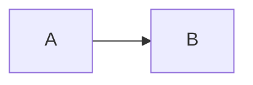

## Emoji

GitHub emoji \:rocket\: shortcodes are rendered as :rocket: emoji.

- :tada: Celebrate the release — \:tada\:
- :bug: Fix the issue — \:bug\:
- :sparkles: Add polish — \:sparkles\:
- :heart: Made with care — \:heart\:
- :fire: Hot fix — \:fire\:
- :memo: Documentation — \:memo\:
- :white_check_mark: All tests pass — \:white_check_mark\:

## Plain

Plain text shortcodes are rendered as text.

- Celebrate the release
- Fix the issue
- Add polish
- Made with care
- Hot fix
- Documentation
- All tests pass

