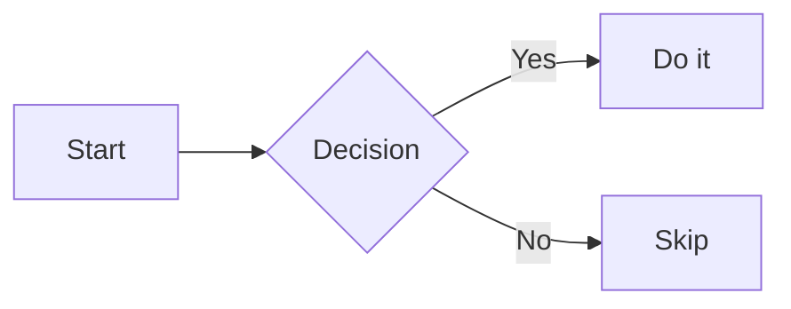
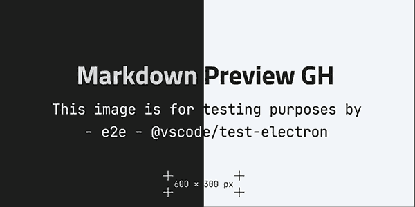

# Block Image Fixture

Intro paragraph that offers no image entry.

> [!NOTE]
> An alert is not a copyable block.

## Table And Code Section

A paragraph inside the section.

| Column | Value |
| ------ | ----- |
| one    | 1     |
| two    | 2     |

```ts
const answer: number = 42;
console.log(answer);
```

## Diagram Section



## Picture Section



## Tail Section

Plain text only.

<div style="height: 1800px"></div>

## Far Section

| Far | Table |
| --- | ----- |
| a   | b     |
